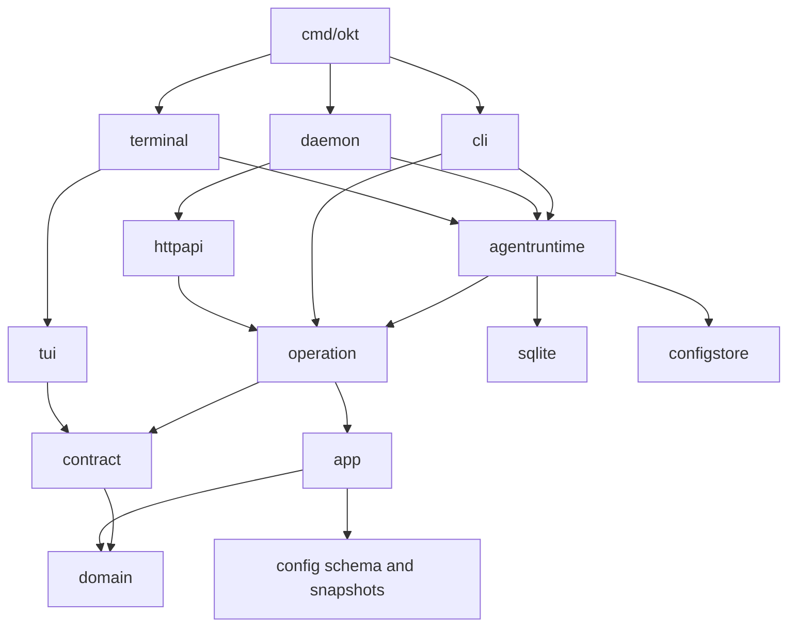

# How it is built

This page is for contributors. The [how-to pages](../README.md) describe using
the product; this one explains which module owns a behavior and how a change
reaches its consumers.

## 1. The model

Omakiten is a local checkpoint store. A project owns tasks, comments, plans,
and their relationships. A workflow package supplies policy and instruction
assets. Application preferences supply language choices across projects.

SQLite stores operational work. Files store workflow packages. The application
builds an immutable configuration snapshot for each project runtime. No SQL
preset registry is needed to activate an installed package.

## 2. Ports and adapters

The domain imports no other internal package. Application services reach I/O
through ports. SQLite and configuration storage are leaf adapters, isolated
from each other.

TUI imports no CLI, concrete operation service, runtime, or storage adapter.
`internal/terminal` binds its ports and starts Bubble Tea. `internal/httpapi`
imports no runtime or storage adapter; `internal/daemon` binds its runtime and
event-log ports. CLI receives both runners injected and imports neither
adapter. The executable composes all three.

| Owner | Responsibility |
| --- | --- |
| `internal/domain` | Business entities, errors, event metadata, and slug policy. |
| `internal/app` | Services, business validation, guards, and repository/editor ports. |
| `internal/contract` | Shared delivery DTOs and narrow operation/recovery ports. |
| `internal/operation` | Surface-gated operations around application services. |
| `internal/cli` | Cobra contracts, help, completion, scope selection, and output. |
| `internal/terminal` | Production bindings for interactive ports. |
| `internal/tui` | Host, routes, screen state, overlays, and asynchronous delivery. |
| `internal/httpapi` | Loopback HTTP routes, Bearer authentication, SSE hub, and the generated OpenAPI document. |
| `internal/daemon` | Server composition, per-project runtime resolution, event-log tailing, lock, token, and discovery file. |
| `internal/config` | Package schema, loading, validation, identities, and snapshots. |
| `internal/configstore` | Filesystem adapter for staged package and asset edits. |
| `internal/sqlite` | Transactions, operational queries, events, sync identity, change capture, remote apply, and live snapshots. |
| `internal/syncproto` | Wire contract of sync: routes, request and response bodies, query encoding. |
| `internal/syncserver` | The `okt-server` HTTP handler, token authentication, and its SQLite row store. |
| `internal/syncclient` | HTTP adapter implementing the sync remote port. |
| `internal/agentruntime` | Bootstrap, per-project runtime cache, reload, and shutdown. |
| `internal/workfile` | Bounded UTF-8 OKF Markdown codec. |
| `internal/knowledgefile` | File-backed Markdown, OpenAPI, and CLI knowledge reader. |
| `internal/recovery` | Recovery images, directory leases, and retention. |
| `internal/filelock` | Non-blocking advisory file locks shared by leases and the daemon. |
| `internal/installer`, `internal/updater` | Package capture, setup, and executable updates. |
| `internal/releaseverify`, `internal/releasemeta` | Release verification policy and metadata. |

`internal/arch` enforces import boundaries; `.golangci.yml` mirrors production
restrictions. Shared projections belong outside delivery implementations.

## 3. Configuration publication

`BundleCache` owns one project runtime per project id. Its construction path
creates the snapshot, registries, operation services, editor, and hook engine.
Services capture coherent snapshot values rather than mutable process globals.

Reload prepares an inactive candidate and asks consumers to accept their staged
replacement. It drains the previous hook engine before publishing the new
runtime. Rejection keeps the accepted runtime intact; failed drain leaves the
candidate unpublished. Close rejects rebuilds and drains cached engines before
closing the database.

Package editing stages the complete package, validates it, installs its new
content identity, and atomically updates the scope's selection. Application
preferences are watched independently of preset edit hashes. Translation
catalogs are embedded and cached; consumers receive independent values.

Agent commands belong to the selected workflow package. Each command is a
skill whose frontmatter declares its name, parameters, and immediate `next`
references. Command bindings select its persona, supporting skills, laws, and
templates. `internal/config` validates both sides, and `internal/operation`
composes the requested command plus one level of related context. The CLI and
Studio consume that composition through shared contracts.

## 4. Work documents and transactions

CLI passes decoded document values through operation contracts to
`app.WorkDocumentService`. The repository transaction covers plan, waves,
tasks, tags, parent links, dependencies, and document metadata.

SQLite binds nested mutations to the transaction context and buffers event
publication. Commit makes the mutations durable before publishing events.
Failure and dry-run roll back the mutations and their events. Export hydrates
the complete record under a consistent transaction snapshot.

Business fields remain in their operational tables. Entity-owned document
metadata preserves file-local keys and producer extensions; export combines
both. The [data model](data-model.md) describes the relationships.

Project knowledge is separate from operational work documents. Its readers
build an in-memory projection from registered project files on each explicit
read or TUI refresh. CLI command inventories are exported from executable
command trees into generated files under `.tmp/`; Markdown frontmatter attaches
guides to commands or OpenAPI operations by stable ID. The TUI prepares one
scrollable interface-first graph from those relations. No knowledge node or relation is
written to SQLite.

## 5. Events and hooks

Each project's snapshot owns event definitions and policy. SQLite prepares
event category, display, summary, and visibility before delivery. Cross-project
log and metric queries interpret events against their originating policy.

The event bus dispatches hooks; each runtime owns an engine and action registry.
Admission, cancellation, and bounded drain belong to the engine: a reload
cancels admitted actions, and an exiting process lets them finish within the
drain bound first, so a one-shot CLI call still runs the hooks of its writes.
Notification actions contain structured operation arguments; terminal
bindings execute them without invoking Cobra or parsing CLI output.

The bus is in-process, so the daemon streams from the events table instead.
It polls `PRAGMA data_version`, which moves when any connection commits, and
reads rows after its id cursor. Writes from the CLI, TUI, agents, and the API
reach SSE clients through that one read.

## 6. Presentation ownership

The screen registry declares routes, labels, factories, chrome, and reload
policy. The host keeps a base screen, detail stack, and navigation history.
Screens receive prepared business projections and emit semantic intents.

Components own cursor, scroll, viewport, geometry, and framing. Screens declare
content, archetypes, styles, and keys. Rendering consumes prepared state.
[TUI screen assembly](tui-screen-assembly.md) is the normative contract.

## 7. Recovery and release boundaries

Database backup, search reindex, and project deletion are operations like any
other: `internal/operation` gates them by surface and delegates to
`agentruntime.Maintenance`. Project deletion and confirmed search reindex use a
directory lease and a live SQLite snapshot before mutation. A pinned connection verifies the database
generation around the transaction. Recovery images include committed WAL data.
Retention follows the same protected directory identity.

The updater verifies release metadata and stages the executable replacement
on the destination filesystem. Strict installers validate signer identity,
provenance, manifest, and archive digests before extraction. Preset installation
validates package integrity and schema, without evaluating script content.

Filesystem validation retains user symlinks for rejection. On macOS, the system
aliases `/var`, `/tmp`, and `/etc` resolve to their corresponding `/private/`
directories before descriptor-relative access. Windows opens synchronous NT
handles with synchronization access and uses Win32 error codes for missing
targets and name collisions.

## 8. Sync

The board is local-first: this machine's database stays the source of truth,
and `okt-server` is a sync peer rather than an owner. A project whose
`projects.sync_scope` is `synced` replicates by row state. Projects left
`local` (the default) record nothing and never reach a server. Usage is in
[the sync how-to](../how-to-sync-projects.md).

### Identity and clock

| Piece | Behavior |
| --- | --- |
| Global identity | `projects`, `tasks`, `events`, `errors`, `solutions`, `plans`, and `plan_waves` carry a unique UUIDv7 `uid`. Integer ids stay local. Join rows have no uid. |
| Event envelope | Every `events` row carries `hlc`, `device_id`, and `actor_id`. |
| Clock text | An HLC renders as `<wall>-<counter>-<device>` with fixed-width decimal wall and counter, so string order is causal order. `domain.TickHLC` and `domain.ObserveHLC` define the clock. |
| One tick | The SQL function `okt_hlc_tick` wraps `domain.TickHLC`. Event stamping and row capture both advance `sync_identity.hlc` through it, so every writer shares one clock. |
| Device identity | `sync_identity` is a singleton row holding `device_id`, `actor_id`, `hlc`, `remote_url`, and the `applying` flag. It is seeded on fresh databases and on upgrade. |
| Schema backfill | An upgrade step may carry a Go backfill that runs in the step's transaction. Version 4 uses it to assign uids and seed the identity. |

### Capture

Triggers in `schema.sql` record each insert, update, and delete of a synced
table's row into `sync_rows`, keyed by (`project_id`, `tbl`, `row_uid`). A
newer entry replaces the older one for the same key, and a stamping trigger
gives the entry the next clock tick. The view `sync_capture_projects` limits
capture to synced projects and turns it off while `sync_identity.applying`
is set, so applied remote rows are never pushed back. Update triggers fire
only on the replicated columns. Activity-log events (`cli.tool_call`,
`tui.tool_call`, listed in `sync_activity_event_types`) are never captured.
Switching a project to `synced` enqueues its existing rows, and deletes that
happened while it was local are recorded as deletes.

| Table | Role |
| --- | --- |
| `sync_rows` | Local changes waiting to be pushed; `local` marks rows that are pending versus rows received. |
| `sync_projects` | Per project, `pushed_hlc` (last pushed stamp) and `pull_cursor` (last server seq applied). |
| `sync_inbox` | Remote changes parked until the row they reference arrives. |
| `sync_identity` | Device, actor, clock, remote URL, and the apply flag. |

### Wire rows

The replicated tables, in apply order, are `projects`, `plans`,
`plan_waves`, `tasks`, `errors`, `solutions`, `events`, `task_dependencies`,
`task_tags`, `error_tags`, and `event_tags`. A `domain.SyncChange` carries
the table, a row uid, the op (`upsert` or `delete`), the stamp, the device,
and the column values. Local integer ids never travel: each foreign key
`x_id` is sent as `x_uid`, and tags by `tag_name`. Join rows use the
`|`-joined uids of their parents as the row id. The project row carries its
name and description only, never `root_path`. Bucket and priority ids are
sent as they are, which is why machines must share the workflow kit; a push
labels the project with its kit key and a clone refuses a different kit.
Workflow configuration is not replicated. `domain.ValidateSyncChange` bounds
every change: known table and op, parsed stamp, scalar data values, and a
wall no more than 24 hours ahead.

### Sync run

`internal/app` `SyncService` drives each synced project through the ports
`SyncStore` and `SyncRemote`. Projects are isolated: one failure is recorded
in that project's report and the others continue, and the CLI exits
non-zero when any report holds an error.

1. Push. Pending changes go up in pages ordered by stamp, and `pushed_hlc`
   advances after each accepted page. A `body_too_large` answer halves the
   page; a single change still too large fails the project. A pull halves
   its page the same way on any HTTP 413.
2. Pull. The client reads pages after `pull_cursor` and hands each to
   `ApplyChanges`. A page that reports more without moving the cursor, or a
   cursor that goes backwards, fails instead of looping.

### Apply

`sqlite.Store.ApplyChanges` runs one batch in one transaction with capture
off. Project scope comes from the rule table: a uid already held by another
project, a project delete, or a bad join row id is a rejected change,
counted in the report and skipped.

- Changes sort by table apply order, then stamp; a row is replaced only by a
  greater stamp. A recorded delete of an entity row beats any upsert and is
  final. Join rows (tags, dependencies) compare deletes by stamp, so they
  can be removed and added again.
- A change stamped too far ahead of the clock is parked, not rejected.
- Each change runs under its own savepoint, so a failing change leaves no
  partial write.
- A change whose reference is missing waits in `sync_inbox`. The inbox is
  targeted: a parked change is retried only when the row it is missing is
  applied. It holds at most 10,000 changes per project, dropping the oldest.
  A change whose required parent was deleted is dropped with it.
- The pull cursor is stored and the local clock observes the greatest
  incoming stamp in the same transaction, so a batch applies completely or
  not at all.

### Server

`internal/syncserver` serves three routes under `/v1` with Bearer tokens
(at least 32 bytes) and bounded request bodies: list projects, push changes
for a project, pull changes after a sequence number. It keeps one row per
(project, table, row uid) in its own SQLite file and gives every accepted
change the next sequence number. Invalid changes are skipped and counted in
the push answer's rejected count. The conflict rule, applied per row:

| Stored | Incoming | Result |
| --- | --- | --- |
| Nothing | Any valid change | Stored. |
| Upsert | Upsert with a greater HLC | Replaces it. |
| Upsert | Upsert with an equal or smaller HLC | Ignored. |
| Upsert | Delete | Replaces it, whatever the HLC. |
| Delete | Anything | Ignored: deletes are final (join rows compare by stamp instead). |

`internal/syncclient` implements `SyncRemote` over HTTP: bounded responses,
no redirects, `https` unless the host is loopback or `OMAKITEN_SYNC_INSECURE`
is set. `internal/agentruntime` supplies the token from
`OMAKITEN_SYNC_TOKEN` or the 0600 `sync.token` in the data directory.

### Why rows, not operations

Replaying operations needs every operation to be deterministic, replayable
on a different database, and ordered consistently across devices, and it
makes a missed or reordered operation corrupt state permanently. Row state
reads the result of each write wherever it came from (CLI, TUI, daemon, or
import), so a new operation needs no sync code. Convergence follows from a
per-row total order, a retry is idempotent, and the server needs no domain
logic.

### Not built

- Per-field merge: rows merge as a whole.
- Background sync in the daemon; sync runs when asked.
- Replication of the workflow configuration.
- Accounts, teams, and permissions; a token is all-or-nothing.
- TLS termination in `okt-server`; run it behind a reverse proxy.
- Sync in the TUI.
- Release archives for `okt-server`.

## Next

- [Working on Omakiten](development.md) — toolchain, tests, gate, and releases.
- [Behavioral requirements](requirements.md) — the invariants a change must preserve.
- [Review guide](review-guide.md) — how to turn evidence into a review finding.
